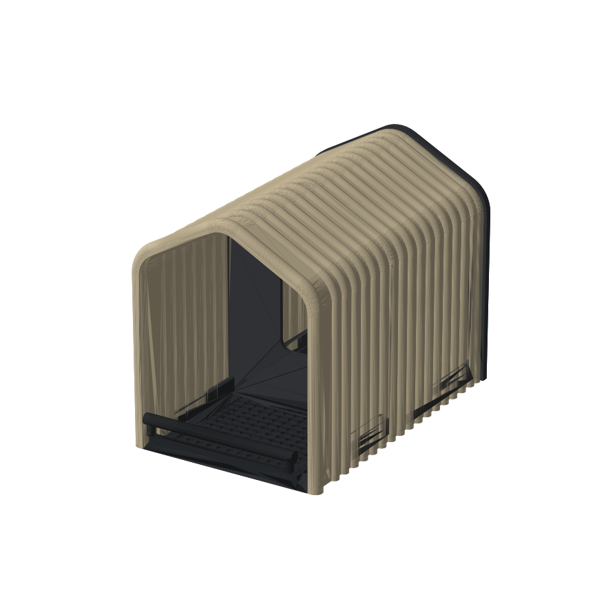

# Fuglekiggeren: a eufyCam bird feeder

A 3D-printed bird feeder that houses a **eufyCam 2C Pro**, powered by a 5 W solar panel. It's made as a gift for grandparents in Denmark.

**Website:** https://balexandre.github.io/eufycam-birdfeeder/



## Repository layout

| Path | What |
|---|---|
| `index.html` | Project website (GitHub Pages, Tailwind + Alpine.js via CDN) |
| `cad/feeder.py` | Parametric model ([build123d](https://github.com/gumyr/build123d)). Change the numbers at the top. |
| `cad/export.py` | Writes every file in `models/` and the renders in `img/` |
| `models/3mf`, `models/stl` | Print-ready parts, already oriented for the bed (Bambu Studio) |
| `models/step` | Editable CAD. Open in Layerling, Fusion, FreeCAD and similar. |
| `models/web` | GLB files for the 3D viewer on the website |

## Rebuilding the model

You need Docker. Nothing else is installed on your machine.

```bash
./cad/build.sh
```

## Parts

Hood (sand), base, window, camera carriage and tray (charcoal). The hardware list, print settings and assembly steps are on the website.

## Credits

The ribbed, house-shaped style was inspired by
[MadeByCastelao's Blink camera feeder](https://cults3d.com/en/3d-model/home/bird-feeder-camera-case-for-blink-camera-madebycastelao).
This is an independent design for a different camera, and no geometry was copied.
